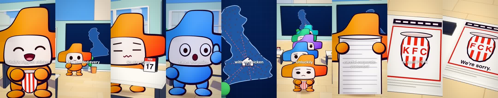

# Skala Shorts — Claude Code skill

Make animated vertical shorts starring **Skala** (and the mini-Skala team) in the house cartoon-3D office style,
from just a **script + voiceover**. English and Bahasa Indonesia.



## Install (once per computer)
1. Install: [Claude Code](https://claude.com/claude-code), Node 18+, Python 3.10+, ffmpeg (`brew install ffmpeg`),
   Google Chrome.
2. Clone this repo into your Claude skills folder:
   ```bash
   git clone <this repo url> ~/.claude/skills/skala-short
   ```
3. Set up the render tools (≈ 5 min, ~1 GB):
   ```bash
   bash ~/.claude/skills/skala-short/bin/setup.sh
   ```
To update later: `cd ~/.claude/skills/skala-short && git pull`.

## Use
Open Claude Code in any folder and say, for example:
> Make a Skala short. Script is in `~/Desktop/episode-12/script.txt`, voiceover is `~/Desktop/episode-12/vo.mp3`.

Claude will: tighten the read (shorter pauses, slightly faster — say "keep my pace" to skip), transcribe it for
captions, plan the shots, stage Skala, build the props and the sound, check stills, render a 1440x2560 MP4
(~10-15 min), and suggest Instagram captions. Ask for changes in plain words ("make the hook faster", "Skala should
facepalm on 'unluckily'", "no captions on the last line").

## What's inside
- `SKILL.md` — the workflow Claude follows.
- `template/` — the Remotion + three.js project (engine in `src/skala/`, per-video files in `src/video/`).
- `audio/` — voice prep, captions, original score + sound effects, mix.
- `examples/kfc/` — the first finished short ("The Chicken Shop With No Chicken").
- `references/` — authoring guide (camera, staging), mascot catalog, sound, style.
- `assets/` — reference frames and the Skala character sheets.

## Changing the look
The style lives in `template/src/skala/` (Skala drawing, office, lighting, ink, captions). Change it there once and
every future video follows. New poses/props go in `template/src/skala/skala.ts` + `references/mascot.md`.
